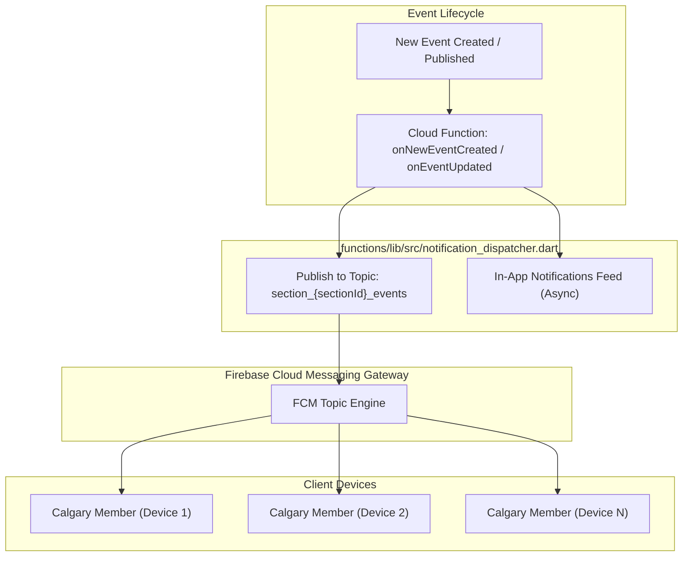

# FCM Notifications Implementation Plan

## Executive Summary
This document outlines the architectural design and execution roadmap for adding **Firebase Cloud Messaging (FCM)** notifications to **aclub2**.

To efficiently broadcast new event announcements to community members (e.g., all Calgary members) without reading thousands of user documents, we adopt **FCM Topic-based messaging**. Direct user notifications (such as registration requests, approval, or withdrawal alerts) will continue to use targeted device tokens. The topic architecture is deliberately designed to allow seamless future extension into granular event sub-types (e.g., ski, hike, climbing).

---

## 1. System Architecture & Notification Strategy

### Dual Messaging Model
| Notification Category | Delivery Mechanism | Trigger | Target Audience | Firestore Reads |
| :--- | :--- | :--- | :--- | :--- |
| **New Event Announcements** | **FCM Topic (`TopicMessage`)** | Event created or transitioned from `draft` to `published` | All subscribed members of that section | **O(1)** (zero member reads) |
| **Direct Activity Alerts** (e.g. withdrawal, pending signup) | **FCM Direct Multicast (`MulticastMessage`)** | Member registers or cancels registration | Specific leaders or the applicant | **O(1)** (only the relevant user doc) |
| **In-App Notification Feed** | **Firestore `/notifications` doc** | Same triggers | User inbox in app bar | Written per-recipient or queried |



---

## 2. FCM Topic Design & Extensibility

### 2.1 Generic Topic Naming Convention (Phase 1)
FCM topic names must match `[a-zA-Z0-9-_.~%]{1,900}`.
- **Section Topic Pattern**: `section_{sanitizedSectionId}_events`
  - Example: For Calgary section (`sectionId = 'calgary'`), topic name is `section_calgary_events`.
  - Example: If section ID contains special characters or spaces, a sanitization helper normalizes it:
    ```dart
    String sanitizeTopicName(String input) =>
        input.replaceAll(RegExp(r'[^a-zA-Z0-9-_.~%]'), '_');
    ```

### 2.2 Future Sub-Type Extensibility (Phase 2+)
When extending to event sub-types (e.g., ski, climbing, social):
- **Option A (Sub-topic per type)**: `section_{sectionId}_events_{type}` (e.g. `section_calgary_events_ski`). Users subscribe only to the sports they care about.
- **Option B (FCM Topic Conditions)**: Send with conditional expression:
  `"'section_calgary_events' in topics && ('type_ski' in topics || 'type_all' in topics)"`.
- **Backward Compatibility**: By establishing `section_{sectionId}_events` as the baseline default today, existing subscribers continue receiving all events until they opt into specific sub-type filters.

---

## 3. Cloud Functions Implementation (`functions/`)

### 3.1 Topic Publisher in `notification_dispatcher.dart`
Refactor `notifySectionMembersOfEvent` to eliminate the loop querying every section member's profile for push tokens:

```dart
/// Notifies all interested members of [sectionId] via FCM topic.
Future<void> notifySectionMembersOfEvent({
  required Firebase firebase,
  required String sectionId,
  required String eventId,
  required String title,
  required String message,
  required String type,
}) async {
  final cleanSection = sanitizeTopicName(sectionId);
  final topic = 'section_${cleanSection}_events';
  final link = '/events/$eventId';
  final data = <String, String>{
    'type': type,
    'sectionId': sectionId,
    'eventId': eventId,
    'link': link,
  };

  if (Platform.environment['FUNCTIONS_EMULATOR'] == 'true') {
    logger.info('[emulator] FCM topic push: topic="$topic", title="$title", eventId=$eventId');
  } else {
    final messaging = firebase.adminApp.messaging();
    final topicMessage = admin_messaging.TopicMessage(
      topic: topic,
      notification: admin_messaging.Notification(
        title: title,
        body: message,
      ),
      data: data,
    );
    final messageId = await messaging.send(topicMessage);
    logger.info('FCM topic message sent: id=$messageId, topic=$topic');
  }
}
```

### 3.2 In-App Notifications Decoupling
For the in-app notification bell, separate it from the push delivery. In-app notifications can be populated asynchronously or generated when members view the section board, preventing Cloud Function execution timeouts when sections grow to thousands of members.

---

## 4. Flutter App Implementation (`lib/`)

### 4.1 Dependency Addition
Add `firebase_messaging` to `pubspec.yaml`:
```yaml
dependencies:
  firebase_messaging: ^15.2.0
```

### 4.2 Native Platform Configuration
- **Android**:
  - Add `POST_NOTIFICATIONS` permission in `AndroidManifest.xml` (Android 13+):
    ```xml
    <uses-permission android:name="android.permission.POST_NOTIFICATIONS"/>
    ```
  - Create default `NotificationChannel` with high importance in `MainActivity` or initialization service.
- **iOS / macOS**:
  - Add `Push Notifications` and `Background Modes` (`Remote notifications`) capabilities in Xcode project.
  - Request user notification authorization with alerts, badges, and sounds.

### 4.3 Notification Service Architecture (`lib/services/fcm_service.dart`)
Create a dedicated `FcmService` responsible for:

1. **Permission Request**:
   - `FirebaseMessaging.instance.requestPermission()`
2. **Device Token Management**:
   - Retrieve `FirebaseMessaging.instance.getToken()`.
   - Update `UserProfile.fcmTokens` in Firestore (`users/{uid}`).
   - Listen to `FirebaseMessaging.instance.onTokenRefresh` to keep Firestore synchronized.
   - Remove token on user sign-out (`UserStateCubit.clear()`).
3. **Topic Subscription Sync**:
   - Maintain synchronization between user preferences and FCM topics:
     ```dart
     Future<void> syncTopicSubscriptions({
       required List<String> memberSectionIds,
       required bool pushEnabled,
       required bool notifyForNewEvents,
     }) async {
       for (final sectionId in memberSectionIds) {
         final topic = 'section_${sanitizeTopicName(sectionId)}_events';
         if (pushEnabled && notifyForNewEvents) {
           await FirebaseMessaging.instance.subscribeToTopic(topic);
         } else {
           await FirebaseMessaging.instance.unsubscribeFromTopic(topic);
         }
       }
     }
     ```
4. **Foreground, Background, & Terminated Handlers**:
   - **Foreground**: `FirebaseMessaging.onMessage` — Display local in-app banner or update notification counter badge.
   - **Background handler**: Top-level function with `@pragma('vm:entry-point')`.
   - **Deep Linking**:
     - Handle app open from notification via `FirebaseMessaging.onMessageOpenedApp` and `FirebaseMessaging.instance.getInitialMessage()`.
     - Extract `sectionId` and `eventId` from message data payload and navigate directly using:
       ```dart
       appRouter.navigate(EventDetailRoute(sectionId: sectionId, eventId: eventId));
       ```

### 4.4 Hooking into App Lifecycle & State Management
- Connect topic sync to `UserStateCubit`:
  - When `UserState` loads (`ensureLoaded`), invoke `fcmService.syncTopicSubscriptions(...)`.
  - When notification preferences change in `UserProfilePage` (`pushEnabled` or `notifyForNewEvents`), invoke topic sync.
  - When user signs out, unsubscribe or purge tokens.

---

## 5. Execution Steps & Phasing

| Step | Scope | Description | Verification |
| :--- | :--- | :--- | :--- |
| **1** | **Backend / Functions** | Update `notification_dispatcher.dart` to use `TopicMessage` for event broadcast; add topic sanitization helper; add emulator logging. | Run functions unit tests & test in Firebase emulator. |
| **2** | **App Dependencies & Native Config** | Add `firebase_messaging` to `pubspec.yaml`, configure Android manifests, notification channel, and iOS entitlements. | App builds cleanly on Android & iOS. |
| **3** | **FCM Client Service** | Create `FcmService` with token registration, permission handling, and deep-link routing. | Verify token stored in Firestore user document. |
| **4** | **Topic Subscription Logic** | Wire topic subscription into `UserStateCubit` and `UserProfilePage` preference toggles. | Test subscribing/unsubscribing when toggling "Notify me of new events". |
| **5** | **Testing & Validation** | Create/publish a new test event; verify message delivery via topic to subscribed devices; test notification tap navigation. | End-to-end event publish -> device push -> tap opens event. |

---

## 6. Future Extension (Sub-Types)
When ready to introduce activity-based filtering (e.g. Ski, Hike, Climb):
1. Add `activityTypes` to `NotificationPreferences`.
2. Introduce sub-topics: `section_${sectionId}_type_${activityType}`.
3. Update `handleNewEventCreated` to publish either to specific activity topics or publish with an FCM condition.

